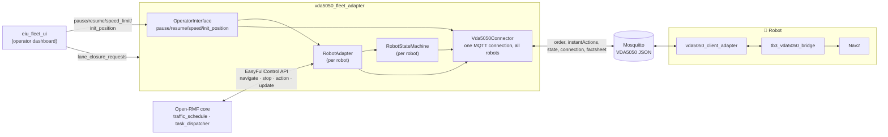
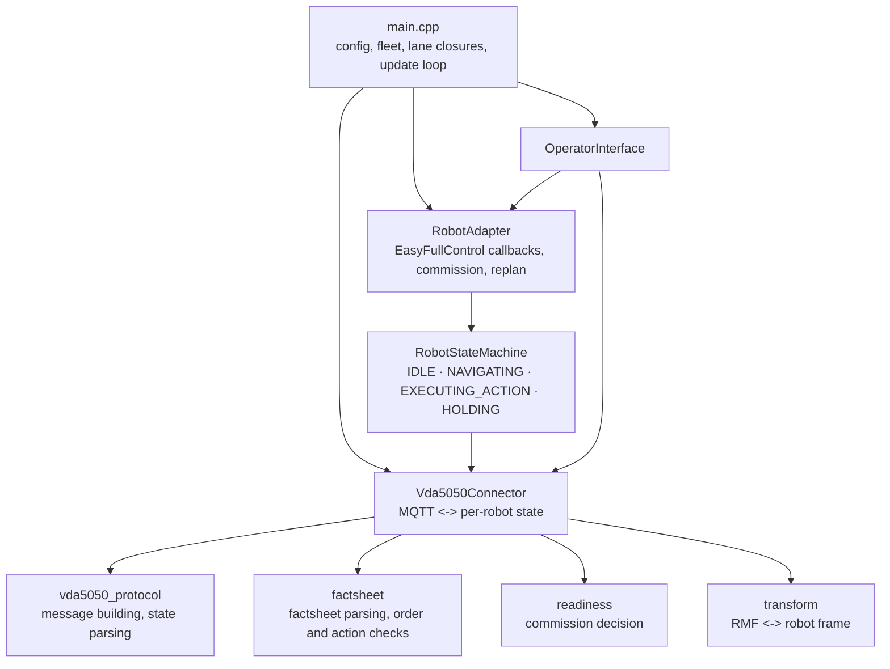
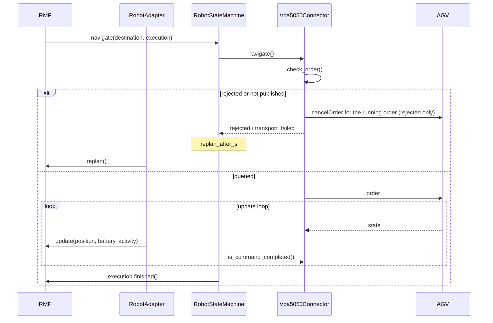
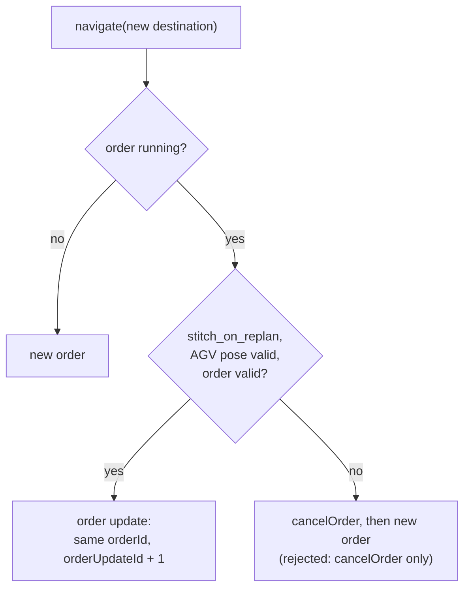
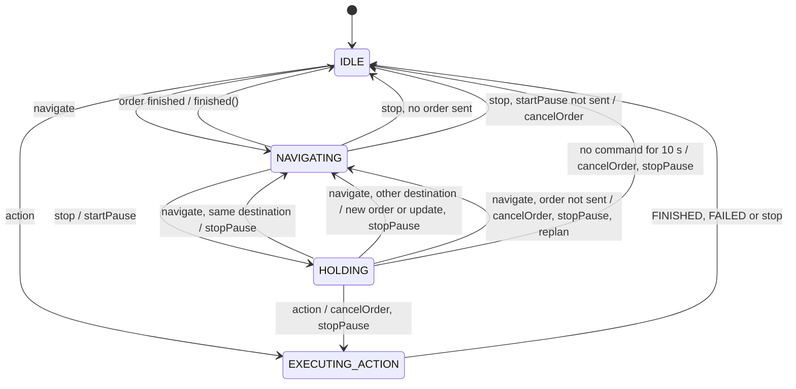
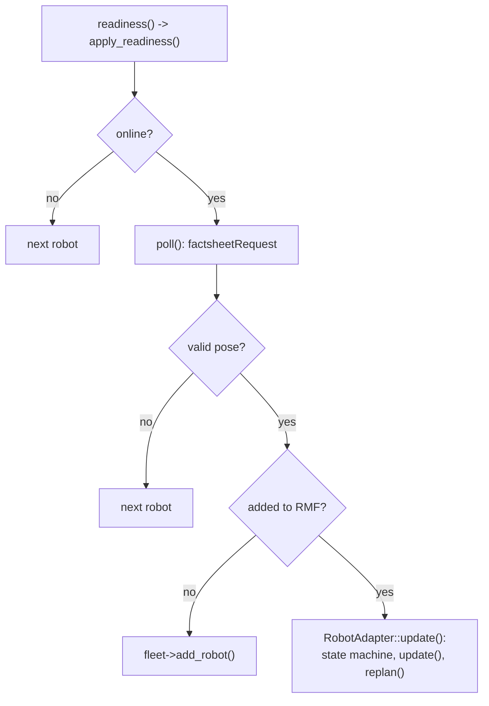

# vda5050_fleet_adapter — Architecture

Bridges Open-RMF to a VDA5050 fleet over MQTT. RMF sees an EasyFullControl fleet adapter (`RobotCallbacks`, `EasyRobotUpdateHandle`); the robots see a VDA5050 master controller.

The main features are listed in [README.md § Key features](../README.md#key-features); this document covers how they are built.

## System architecture

The system has four parts:
- Open-RMF plans routes, manages traffic and assigns tasks.
- This adapter turns RMF commands into VDA5050 orders and instant actions, and reports each robot's state back to RMF.
- An MQTT broker (Mosquitto) carries the VDA5050 messages.
- Each robot runs a VDA5050 client. On the TB3 robots this is `vda5050_client_adapter`, which drives Nav2 through `tb3_vda5050_bridge`.

Stock RMF handles traffic negotiation (`rmf_traffic_schedule`). The adapter executes the destinations RMF gives it.

### Interfaces

| Other side | Messages | Protocol |
|:---:|---|:---:|
| RMF core | `navigate`, `stop`, `action` callbacks in; `update`, `replan`, `set_commission` out | In-process RMF API |
| AGVs (via the broker) | `order`, `instantActions` out; `state`, `connection`, `factsheet`, `visualization` in | MQTT |
| `eiu_fleet_ui` | In: `<robot>/pause`, `<robot>/resume` (`std_srvs/Trigger`), parameter `speed_limit.<robot>`, `<robot>/init_position`, `/lane_closure_requests`. Out: `<robot>/init_position_result` | ROS 2 |

Operator topics and services are under the node name, for example `vda5050_fleet_adapter_tb3/tb3_1/pause`.

## Component view

An arrow points from a component to a component it uses.

| File | Role |
|:---:|---|
| `main.cpp` | Reads the config, creates the fleet with `Adapter::add_easy_fleet`, adds the robots once they report a pose, applies lane requests, runs the update loop |
| `robot_adapter.*` | EasyFullControl callbacks of one robot; passes RMF updates, commission changes and replan requests to RMF |
| `robot_state_machine.*` | Holds the active `CommandExecution` or `ActionExecution`, reports completion, runs the traffic hold |
| `vda5050_connector.*` | One Paho connection and one `RobotContext` per robot. Downlink: `navigate`, `stop`, `pause`, `resume`, `init_position`, `execute_instant_action`, `poll`. Uplink: `get_data`, `readiness`, `is_command_completed`, `get_action_state` |
| `vda5050_protocol.*` | Builds `order` and `instantActions`; parses `state` into `ParsedState`. No MQTT, no RMF |
| `factsheet.*` | Parses the factsheet; `check_order`, `check_instant_action`, `action_conflicts` |
| `readiness.*` | `evaluate_readiness`: whether a robot may take tasks |
| `operator_interface.*` | ROS services, topics and parameters of the operator controls |

## Key flows

### Order dispatch and completion

RMF calls `navigate` with one destination. The adapter sends one order and reports completion when the AGV's state shows the order finished at the destination.

Steps:
1. The nodeId of the destination is its waypoint name, else `wp_<graph index>`, else `<x>_<y>`.
2. `Vda5050Connector::navigate` builds the order: base node at the AGV's reported pose (`lastNodeId`, or `<serial>_start`), end node at the destination, one edge. The edge `maxSpeed` is the lower of RMF's speed limit and the operator's speed limit.
3. If an order is still running, it is cancelled first, or the new destination is sent as an order update (see [Order replacement](#order-replacement)).
4. The order is checked ([Factsheet and validation](#factsheet-and-validation)) and published. It is tracked only after MQTT accepts it.
5. On each update pass, `is_command_completed` checks the state: same `orderId`, not driving, `lastNodeId` equal to the destination, no `nodeStates` or `edgeStates` left. Then `CommandExecution::finished()` is called.

When the order is rejected or not published, nothing is tracked, the completion check is skipped, and RMF is asked to replan after `replan_after_s`.

A drained order whose `lastNodeId` differs from the destination is logged once, since it never completes.

### Order replacement

An order counts as running while the AGV reports its `orderId` and has not finished it at its destination.

The new order follows the `cancelOrder` at once; the adapter does not wait for the AGV's answer.

### Traffic hold

RMF calls `stop` when a robot must wait. The adapter pauses the AGV instead of cancelling the order.

Rules:
- `stopPause` is not sent while the operator has paused the robot.
- An operator resume during `HOLDING` sends no `stopPause`. It clears the operator pause; the hold ends with the next RMF command or the 10 s timeout.
- The AGV's `paused` does not decommission the robot during `HOLDING` and for 3 s after the adapter's own `stopPause`.
- A `navigate` during `EXECUTING_ACTION` fails the action (`ActionExecution::error`). A `stop` releases it, but the AGV keeps running the action: VDA5050 cannot cancel a running instant action.

### Factsheet and validation

The adapter reads the AGV's retained `factsheet`. Without one, `poll` sends `factsheetRequest` 5 s after the robot comes online, then every 20 s, up to 3 times.

| Factsheet field | Used for |
|:---:|---|
| `protocolFeatures.agvActions` | Blocking type of each action; actions the AGV accepts |
| `protocolLimits.maxArrayLens` | `order.nodes`, `order.edges` limits |
| `protocolLimits.timing.minOrderInterval` | Shortest time between two orders |

Checks before an order or instant action is published:

| Severity | Condition | Effect |
|:---:|---|:---:|
| Hard | a pose is not finite | order rejected |
| Hard | the `mapId` is not among the maps the AGV reports | order rejected |
| Hard | 2 nodes or 1 edge exceed `maxArrayLens` | order rejected |
| Hard | a custom action is missing from the factsheet | action not sent |
| Soft | order inside `minOrderInterval`; a core action (`cancelOrder`, `startPause`, `stopPause`, `stateRequest`, `initPosition`, `factsheetRequest`) missing from the factsheet | warning |
| Soft | a non-`NONE` action while the AGV drives; any action while a HARD-only action runs | warning |

With `strict_validation: false`, hard violations are logged only. Without a factsheet, the factsheet checks are skipped and the blocking type is the adapter's default.

### Commission state

`evaluate_readiness` decides after each update pass whether RMF may give the robot tasks. `RobotAdapter::apply_readiness` applies a change with `set_commission`. A robot is commissioned while:
- it is online: the last `connection` is `ONLINE` (or none was received) and the last state is at most 10 s old;
- its pose is initialized;
- its operating mode is `AUTOMATIC` or `SEMIAUTOMATIC`;
- it reports no eStop, field violation or FATAL error;
- it is not paused, except by the adapter's own hold.

The reason of a decommission is logged. RMF registers a robot asynchronously, so a change is retried on the next pass until the robot's handle exists.

### Set position (`initPosition`)

A pose on `<robot>/init_position` is transformed to the robot frame and sent as `initPosition` on the map the AGV last reported. The result is published on `<robot>/init_position_result`: `ok`, the AGV's `resultDescription` on `FAILED`, or an error after 10 s without an answer.

## Runtime behaviour

### Update loop

The loop runs at `update_rate_hz`. For each robot:

### Inbound messages

`Vda5050Connector::message_arrived` parses each message as JSON and drops invalid JSON. It matches the robot by `/<manufacturer>/<serial>/` in the topic and ignores other robots.

| Topic | Effect |
|:---:|---|
| `state` | Replaces the robot's state; logs changes of errors, pause, safety state and operating mode |
| `connection` | Online or offline; `ONLINE` restarts the factsheet requests |
| `factsheet` | Replaces the parsed factsheet |
| `visualization` | Subscribed, not used |

### Threads

RMF callbacks run on RMF's executor, MQTT callbacks on Paho's thread, the update loop on its own thread. `Vda5050Connector` guards its robot state with one mutex and calls Paho outside it. `RobotStateMachine` has its own mutex; `replan()` is called outside it.
